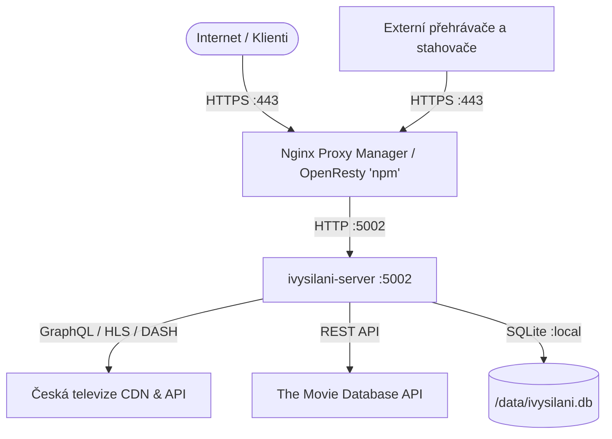

# AGENT_HANDOVER.md: iVysílání Server

> **Předávací dokument pro AI agenty a vývojáře.**  
> Tento dokument obsahuje kompletní technický kontext, architekturu, konfiguraci produkčního prostředí, přihlašovací údaje, známé zvláštnosti (quirks) a operační příkazy projektu **iVysílání Server**.  
> **Pravidlo pro každého agenta:** Při jakýchkoliv architektonických změnách, přidání nových funkcí nebo opravách chyb **VŽDY aktualizujte tento soubor i `CHANGELOG.md`**.

---

## 1. Základní informace a stav projektu

- **Verze projektu:** `2.3.1` (definována v `app/version.py`)
- **Stav:** Plně funkční a nasazeno v produkci
- **Repozitář:** `https://github.com/TheLittleRock/ivysilani-server.git` (větev `main`)
- **Lokální cesta:** `/home/ubuntu_laptop/Python/IVysilani`
- **Produkční doména:** `https://ct.thelittlerock.cz/`
- **Vzdálený hostitel:** Server `koleje` (přístup přes `ssh koleje`)
- **Kontejner:** Docker kontejner `ivysilani-server` (image `ghcr.io/thelittlerock/ivysilani-server:latest`, automatický GitHub Actions build)

---

## 2. Produkční infrastruktura a síťová topologie

Všechny klíčové služby běží na vzdáleném serveru `koleje` pod Dockerem ve sdílené síti `proxy_net`:



| Kontejner | IP v `proxy_net` | Port | Popis |
| :--- | :--- | :--- | :--- |
| `ivysilani-server` | `172.18.0.10` | `5002` | Hlavní FastAPI aplikace (Python 3.10/3.14) |
| `npm` | `172.18.0.x` | `80, 443, 81` | OpenResty / Nginx Proxy Manager (reverzní proxy `ct.thelittlerock.cz`) |
| `stream-cinema-m3u`| `172.18.0.x` | `8080` | Doplňkový streamovací server |

### Cesty na hostiteli `koleje`:
- Databáze a logy: `/opt/homelab/ivysilani-server/data/` (mapováno do `/data/` v kontejneru)
- Log serveru: `/data/logs/ivysilani.log`
- Databáze: `/data/ivysilani.db`
- Stahování: `/opt/homelab/ivysilani-server/downloads/` (mapováno do `/downloads/`)

---

## 3. Kredenciály a přístupové údaje

- **Web Administrátor:** `admin` (heslo je změněno v produkci, původní default `admin`)
- **Produkční Token uživatele:** `ed78b3b873e850ad9eb9029e4fb61f83`
- **Sekundární token uživatele:** `466ced59be1a6ec2086c981a2d4e73bf`
- **TMDB API klíč:** `2f453df93e1dd76ca1e176029a0f9baf` (uložen v tabulce `app_settings` pod klíčem `tmdb_api_key`)

### Veřejné endpointy pro klienty:
- **Web UI:** `https://ct.thelittlerock.cz/`
- **OpenAPI Dokumentace:** `https://ct.thelittlerock.cz/docs`
- **Verze API:** `https://ct.thelittlerock.cz/api/version`
- **M3U Playlist:** `https://ct.thelittlerock.cz/get.php?token=ed78b3b873e850ad9eb9029e4fb61f83&type=m3u_plus`
- **XMLTV EPG:** `https://ct.thelittlerock.cz/xmltv.php?token=ed78b3b873e850ad9eb9029e4fb61f83`
- **Stremio Manifest:** `https://ct.thelittlerock.cz/stremio/ed78b3b873e850ad9eb9029e4fb61f83/manifest.json`
- **StreamCube Manifest:** `https://ct.thelittlerock.cz/streamcube/ed78b3b873e850ad9eb9029e4fb61f83/manifest.json`
- **Xtream Codes Server:** `https://ct.thelittlerock.cz` (Port 443, SSL zapnuto)
  - Přihlášení: buď `username = token` & `password = token`, nebo standardní uživatelské jméno a heslo.

---

## 4. Architektura a klíčové subsystémy

### A. Obcházení DRM a HbbTV Fallback Pipeline (`app/services/ct_service.py`)
Česká televize u prémiových pořadů a vybraných živých streamů (např. *StarDance*, filmy vyžadující licenční ochranu) vynucuje Widevine DRM (`encryption == "wv"` nebo `drmOnly=true`).
- **VOD Pořady:** Server se nejprve pokusí získat unencrypted HbbTV 1080p stream přes HbbTV rozhraní ČT (`type=hbbtv`). Pokud není k dispozici, generuje virtuální lokální DASH MPD manifest patchovaný s PSSH a KID boxy.
- **Živé vysílání (Live TV DRM Bypass):** Pokud oficiální živý feed hlásí DRM ochranu, server požadavek na `/live/...` transparentně přesměruje na plovoucí unencrypted timeshift okno (`timeshift_url` s parametry `&start={now - 60}&duration=14400`). Tím je zajištěn čistý, unencrypted 1080p HLS stream se zvukem i titulky na všech zařízeních bez červené varovné obrazovky.

### B. EPG & Timeshift / Catch-up Scraper (`app/services/epg_service.py`, `app/api/xtream.py`)
- Scraper pravidelně stahuje kompletní TV program pro všech 14 stanic z `ceskatelevize.cz` v okně 14 dní (dnes ± 7 dní).
- Každý pořad v tabulce `epg_programmes` má uložen název, popis, začátek, konec a `idec` kód.
- **Catch-up routing:** Když klient pošle požadavek na zpětné zhlédnutí přes `/streaming/timeshift.php` nebo `/timeshift/...`:
  1. Server vyhledá v EPG přesný pořad podle času vysílání.
  2. Pokud najde `idec`, přesměruje na čistý VOD HLS stream pořadu (`/api/hls/master/{idec}.m3u8`).
  3. Pokud ne, přesměruje na unencrypted HbbTV timeshift stream ČT s patřičným časovým oknem.
- **Podporované časové formáty:** `YYYY-MM-DD:HH-MM`, `YYYYMMDDHHMMSS`, `YYYYMMDDHHMM`, Unix timestamp.

### C. Vertikální plakáty & Image Proxy (`app/services/image_proxy.py`, `scripts/enrich_all.py`)
- Pro Stremio, TiviMate a další přehrávače jsou horizontální obrázky neestetické.
- Server preferuje oficiální vertikální plakát `cardPortrait` z GraphQL API České televize.
- Následně ověřuje plakát na TMDB API v poměru 2:3.
- Pokud je dostupný pouze horizontální plakát, `/api/image-proxy` provede canvas padding do poměru 2:3 s barevným vzorkováním okrajů (edge color sampling) bez deformace či ořezu obrazu.

### D. Kompatibilita s externími stahovači a Go klienty (`app/api/xtream.py`)
- Go unmarshaler v klientských aplikacích striktně vyžaduje `stream_id` a `series_id` jako celá čísla (`int`), nikoliv textové řetězce.
- Funkce `to_int_id()` garantuje, že všechny VOD a seriálové položky posílají celočíselná ID.
- **Season struktura v `get_series_info`:** Každá epizoda uvnitř `episodes[season_key]` i její podobjekt `info` MUSÍ obsahovat pole `"season": s_num` (typu `int`), `"season_num": s_num` a `"season_number": s_num`. Pokud toto pole chybí, Go struct unmarshaler ponechá `ep.Season = 0` a vytvoří název souboru s chybným `S00` (např. `Show.S00E01.mp4`).
- Server používá `GZipMiddleware`, čímž zmenšuje velikost katalogu z 570 KB na ~45 KB a předchází 502 chybám z důvodu přetečení proxy bufferu.

### E. Synchronizace WebVTT titulků (`app/api/stream.py`)
- WebVTT soubory z CDN České televize začínají časovou osu od `00:00:00.000`.
- Výchozí hodnota `settings.SUBTITLE_OFFSET_SECONDS` je nastavena na `0.0s` (nativní přesné časování). Pro uživatelské doladění je k dispozici pole v `/admin#subtitles-settings` (ukládá se do tabulky `app_settings` pod klíčem `subtitle_offset_seconds`).
- Pro HLS přehrávače (VLC, TiviMate, ExoPlayer) server automaticky injektuje hlavičku `X-TIMESTAMP-MAP=LOCAL:00:00:00.000,MPEGTS:0` pro synchronizaci s MPEGTS časovou osou videa.

### F. Stahování WebVTT titulků v externích klientech (`app/api/stream.py`)
- Externí stahovače implementují stahování a spojování titulků podle standardu HLS RFC 8216:
  1. **Segmented HLS VTT:** URI titulků v master playlistu `#EXT-X-MEDIA:TYPE=SUBTITLES` musí odkazovat na `.m3u8` playlist (`/api/hls/subtitles/{idec}.m3u8`).
  2. Uvnitř tohoto subtitle playlistu musí segmentové URL končit příponou `.vtt` (`/api/subtitles/{idec}.vtt`). Stahovač stáhne segment `0.vtt` a spolehlivě jej zabalí do MP4 (`Stream #0:2: Subtitle: mov_text`).
  3. Master playlist VŽDY odkazuje na `/api/hls/subtitles/{idec}.m3u8`.
  4. **Struktura master playlistu podle RFC 8216:** Všechny audio i subtitle `#EXT-X-MEDIA` tagy musí být umístěny na začátku souboru před variantami `#EXT-X-STREAM-INF:`. Za každým `#EXT-X-STREAM-INF:` musí bezprostředně následovat video URL (nesmí být proloženo dalším `#EXT-X-MEDIA` tagem, jinak parser variantu zahodí). Každý `#EXT-X-STREAM-INF:` obsahuje atribut `SUBTITLES="subs"`.

---

## 5. Důležité zvláštnosti a pasti (Known Quirks & Gotchas)

1. **Struktura souborů v Docker kontejneru (`/app/app/` vs `/app/`):**
   - V produkčním kontejneru `ivysilani-server` spouští uvicorn příkaz `python3 run.py`, který importuje modul `app.main:app`.
   - V souborovém systému kontejneru se zdrojové kódy nacházejí v `/app/app/` (např. `/app/app/api/xtream.py`).
   - Při přímém kopírování souborů přes `docker cp` je nutné kopírovat do `/app/app/<cesta>`!
2. **Normalizace slugů v `series_id`:**
   - Některé části systému předávají `series_id` se slugem (např. `13478071605-oktopus`). Databáze však používá čisté numerické ID `13478071605`. Vždy používejte `s_id.split("-")[0]`.
3. **Stremio vs StreamCube manifest:**
   - Stremio manifest (`/stremio/.../manifest.json`) striktně vynechává Live TV (`types: ["series", "movie"]`), protože Stremio nativně nepodporuje M3U live playback.
   - StreamCube manifest (`/streamcube/.../manifest.json`) naopak Live TV a IPTV podporuje (`types: ["series", "movie", "tv", "iptv", "stream"]`).
4. **Číslování dílů v seriálech (Episode Numbering per Season):**
   - V ČT GraphQL API a Apollo state mohou být epizody více sérií vráceny v jednom poli, přičemž epizody bez číselného označení v názvu (např. *Čtyřlístek*) by při globálním číslování dostaly posunuté indexy (S01E04..S01E10, S02E11..S02E16).
   - V `app/services/ct_service.py` i `app/api/xtream.py` je implementován per-season čítač a normalizační pass, který garantuje, že v každé sérii začíná číslování dílů od 1 (`1..N`).
5. **Zarovnání sérií a epizod podle TMDb (TMDb Alignment):**
   - Mnoho seriálů na iVysílání nemá vytvořené série (např. *Komisař Montalbano*, *13. komnata*, *Pan Tau*, *Dobrodružství kriminalistiky*, *Nemocnice na kraji města*) a ČT je vrací jako jednu dlouhou sérii 1.
   - TMDb je však člení do reálných televizních sérií (např. Montalbano 15 sérií, 13. komnata 16 sérií).
   - `tmdb_service.align_show_episodes(show_id)` páruje epizody podle normalizovaných názvů a kmenů slov a přeindexuje `season` a `episode_num` přímo v SQLite tabulce `episodes`.
   - V `get_series_info` probíhá on-demand ověření a zarovnání při prvním dotazu klienta.
   - V administraci je dostupné tlačítko a endpoint `/api/admin/reindex-tmdb` pro hromadné přeindexování celého katalogu na pozadí.

---

## 6. Užitečné operační příkazy

### Rychlá kontrola stavu serveru:
```bash
# Kontrola zdraví a verze
curl -s https://ct.thelittlerock.cz/api/version

# Kontrola logů na serveru koleje
ssh koleje 'docker logs --tail 50 ivysilani-server'

# Kontrola chyb v OpenResty / NPM
ssh koleje 'docker exec npm tail -n 50 /data/logs/proxy-host-3_error.log'
```

### Nasazení upravených souborů na produkci:
```bash
# 1. Zkopírování souboru na vzdálený server
scp app/api/xtream.py koleje:/tmp/xtream.py

# 2. Vložení do kontejneru a restart
ssh koleje 'docker cp /tmp/xtream.py ivysilani-server:/app/app/api/xtream.py && docker restart ivysilani-server'
```

### Inspekce SQLite databáze:
```bash
ssh koleje 'docker exec ivysilani-server python3 -c "
import sqlite3
conn = sqlite3.connect(\"/data/ivysilani.db\")
c = conn.cursor()
c.execute(\"SELECT COUNT(*) FROM shows WHERE show_type=\x27movie\x27 AND is_playable=1\")
print(\"Filmy:\", c.fetchone()[0])
c.execute(\"SELECT COUNT(*) FROM shows WHERE show_type=\x27series\x27 AND is_playable=1\")
print(\"Seriály:\", c.fetchone()[0])
c.execute(\"SELECT COUNT(*) FROM epg_programmes\")
print(\"EPG programů:\", c.fetchone()[0])
"'
```

---

## 7. Kontrolní seznam před dokončením úkolu (Handover Checklist)

Při dokončení libovolného úkolu vždy:
1. Zkontrolujte, zda kód neobsahuje syntax chyby a prochází testy.
2. Zaktualizujte `CHANGELOG.md` s popisem změn a odpovídající verzí.
3. Pokud se změnila architektura, proměnné nebo chování rozhraní, aktualizujte tento soubor `AGENT_HANDOVER.md`.
4. Commitněte změny do repozitáře `main` a nasaďte do produkčního kontejneru.
